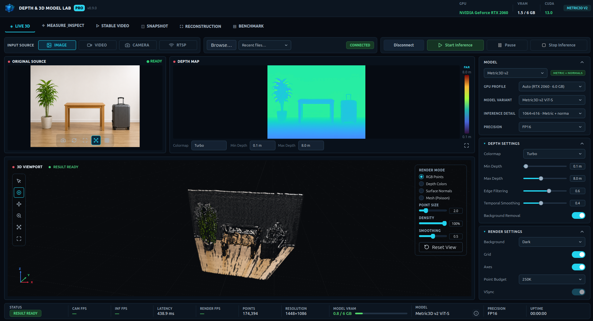
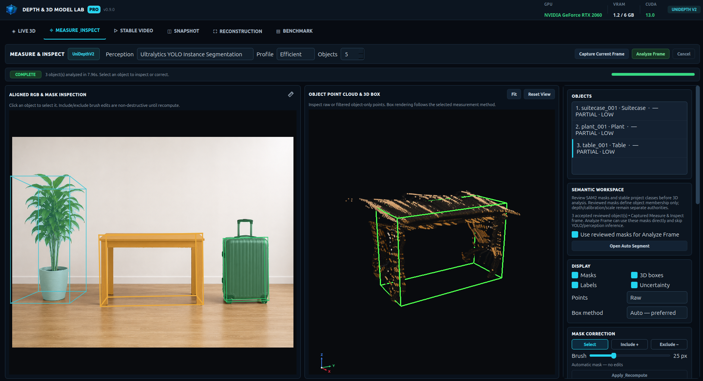

# Depth & 3D Model Lab

GPU-accelerated desktop workspace for monocular depth estimation, interactive 3D visualization, semantic inspection, and 3D reconstruction.



*Live RGB-to-depth inference with interactive depth-map and 3D point-cloud visualization.*



*Segmentation-assisted object inspection with object-level point extraction and 3D geometry.*

## Highlights

- Live depth inference from images, video, USB cameras, and RTSP streams
- Interactive RGB, depth-map, and 3D point-cloud visualization
- Segmentation-assisted measurement and inspection
- Stable Video and Snapshot workflows
- Live and offline reconstruction
- Hardware-aware GPU configuration and runtime profiling
- Isolated model, benchmark, and reconstruction runtimes

## Depth models

MoGe-2 · Depth Pro · UniDepthV2 · Metric3D v2 · Depth Anything V2 · Video Depth Anything · Marigold

## Application modes

`Live 3D` · `Measure & Inspect` · `Stable Video` · `Snapshot` · `Reconstruction` · `Benchmark`

## Reconstruction

The reconstruction workspace combines classical geometry, learned depth, semantic perception, and neural scene representations while keeping geometry, semantics, measurement, and appearance responsibilities explicit.

| Stage | Method |
| --- | --- |
| Camera motion & sparse geometry | Visual SLAM and PyCOLMAP Structure-from-Motion |
| Dense geometry | Multi-view depth projection, filtering, and fusion |
| Learned depth support | Monocular depth providers and Depth Anything 3 supporting geometry |
| Semantic geometry | Segmentation-driven object point extraction and 3D geometry |
| Surface representation | Persistent canonical geometry and surface-mesh workflows |
| Neural appearance | Gaussian Splatting and NeRF / Nerfacto |
| Persistence | Reopenable reconstruction sessions with camera, scale, and provenance metadata |

### Reconstruction flow

`Capture / Images` → `Camera poses & sparse map` → `Depth / multi-view geometry` → `Dense fusion` → `Canonical scene`

Semantic objects and measurements are registered against the scene rather than replacing its canonical geometry. Gaussian Splatting and NeRF/Nerfacto are treated as appearance representations, not authoritative metric geometry.

Measurements remain engineering estimates unless qualified calibration or reference evidence establishes metric scale.

## Requirements

- Ubuntu 24.04 LTS
- Python 3.11 or 3.12
- NVIDIA GPU with a CUDA-compatible PyTorch installation recommended for accelerated inference

## Installation

```bash
python3.12 -m venv .venv
source .venv/bin/activate
python -m pip install --upgrade pip
python -m pip install -e ".[dev]"
```

Optional model runtimes are installed independently through the files under `requirements/`.

Example:

```bash
python -m pip install -r requirements/models-moge2.txt
```

## Run

```bash
./scripts/run.sh
```

or:

```bash
python main.py
```

## Hardware check

```bash
python scripts/check_hardware.py --assert-ready --require-cuda
```

The runtime uses CUDA availability, GPU memory, and hardware capability to select an appropriate execution profile.

## Tech stack

Python · PyQt6 · PyTorch · CUDA · OpenCV · VisPy · PyCOLMAP · Ultralytics · SAM

## Project status

Current application version: **v0.9.0**

The project is under active development.
